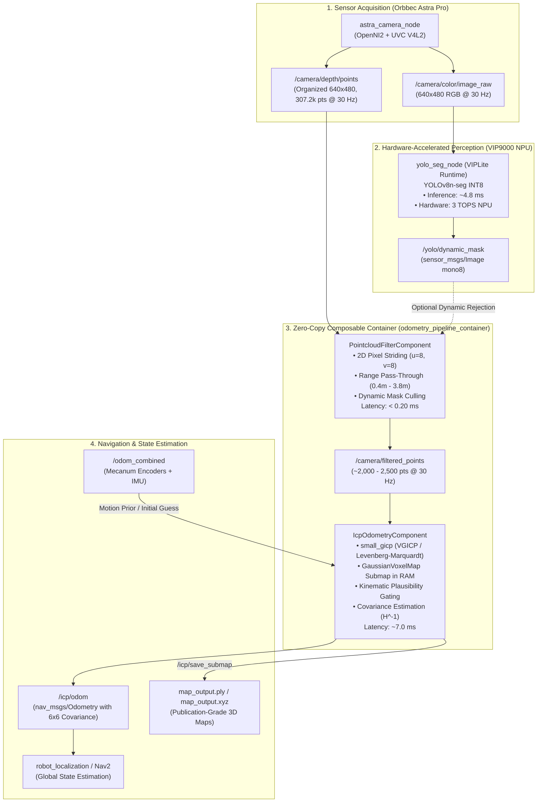

# Holodex Orange: High-Performance 3D Odometry & Neural Perception Stack

[](https://docs.ros.org/en/humble/index.html)
[-orange.svg)](http://www.orangepi.org/)
[-green.svg)](https://www.verisilicon.com/)
[](LICENSE)

An optimized, real-time 3D perception, point cloud odometry, and neural instance segmentation framework designed for autonomous mobile robots operating under strict compute, thermal, and payload constraints (SWaP). 

Developed for a **4WD Mecanum wheeled robot** equipped with an **Orbbec Astra Pro RGB-D camera** and powered by an embedded **Orange Pi 4 Pro** Single Board Computer running **Ubuntu 22.04 LTS** and **ROS 2 Humble**.

---

> [!IMPORTANT]
> ### 🚀 Inicialização Rápida do Robô (Orquestrador Central)
> Para inicializar o sistema completo do robô com telemetria em tempo real, monitoramento térmico/CPU da SBC, odometria visual 3D (small_gicp), odometria de rodas e supervisão de nós:
> ```bash
> # 1. Conectar na Orange Pi
> ssh orangepi@150.164.212.230  # ou orangepi@holodex.local
>
> # 2. Carregar o ambiente e iniciar o orquestrador
> source /opt/ros/humble/setup.bash
> source ~/ros2_ws/install/setup.bash
> ros2 run holodex_bringup holodex_orchestrator
> # Ou inicializar com Nav2 ativo desde a partida:
> # ros2 run holodex_bringup holodex_orchestrator --nav2
> ```
> **Atalhos no painel interativo:**
> * `[n]` Alternar Nav2 On/Off dinamicamente
> * `[s]` Salvar submapa 3D consolidado (`.ply` e `.xyz`)
> * `[e]` Parada de emergência imediata (corte de `/cmd_vel`)
> * `[k]` Matar processos órfãos e concorrentes
> * `[r]` Reiniciar nós do sistema
> * `[l]` Exibir logs recentes
> * `[q]` Encerramento limpo e seguro

---

## 1. System Architecture

The software architecture is modularized into composable ROS 2 components and hardware-accelerated binaries:



---

## 2. Repository Structure

```text
.
├── firmware/
│   └── esp32_firmware/               # ESP-IDF micro-ROS firmware for ESP32 & ESP32-P4
│       ├── main/                     # micro-ROS node (Heartbeat pub, LED sub, auto-reconnect)
│       ├── launch/                   # micro_ros_agent.launch.py for ROS 2 Humble
│       └── scripts/                  # Automated setup, udev rules, and flashing scripts
│
├── Models/
│   └── yolov8n_seg_final.nb          # Compiled INT8 network binary for VeriSilicon VIP9000 NPU
│
├── ORBBEC-ASTRA-PRO/
│   ├── README.md                     # Camera setup, OpenNI2 driver, and UVC configurations
│   ├── orbbec_ws/                    # ROS 2 workspace containing astra_camera packages
│   └── scripts/                      # Camera startup, diagnostic, and build scripts
│
├── pointcloud_odometry/
│   ├── CMakeLists.txt                # Build configuration with OpenMP and ROS 2 components
│   ├── package.xml                   # Package dependencies
│   ├── README.md                     # Dedicated documentation for point cloud odometry
│   ├── config/
│   │   └── params.yaml               # Runtime parameters (strides, ranges, ICP thresholds)
│   ├── include/pointcloud_odometry/  # C++ headers (composable components)
│   ├── launch/
│   │   └── pointcloud_odometry.launch.py # Multi-threaded composable container launch
│   ├── scripts/
│   │   ├── pipeline_orchestrator.py  # Interactive CLI diagnostic & map-saving monitor
│   │   └── save_map.py               # Map export utility script
│   ├── src/
│   │   ├── icp_odometry_component.cpp    # Core VGICP odometry & Gaussian voxel submap
│   │   ├── icp_odometry_node.cpp         # Standalone wrapper executable
│   │   ├── pointcloud_filter_component.cpp # Fast 2D pixel-striding filter
│   │   └── pointcloud_filter_node.cpp    # Standalone filter executable
│   └── third_party/small_gicp/       # High-efficiency GICP/VGICP C++ header-only library
│
├── yolo_seg_ros2/
│   ├── CMakeLists.txt                # VIPLite + OpenCV + ROS 2 build recipe
│   ├── package.xml                   # Package manifest
│   ├── README.md                     # YOLOv8-seg NPU architecture and user guide
│   ├── GUIA_REPRODUCAO_QUANTIZACAO.md# Model export, INT8 PTQ quantization guide
│   ├── GUIA_USO_INFERENCIA_VIPLITE.md# VIPLite API programming reference
│   ├── scripts/
│   │   └── run_yolov8_inference.sh   # Standalone inference & validation script
│   └── src/
│       └── yolo_seg_node.cpp         # NPU inference, DFL box decoding, and mask matmul
│
├── GEMINI.md                         # Detailed engineering log, pitfalls, and future roadmap
└── README.md                         # This file
```

---

## 3. Key Technical Innovations

### 1. 2D Pixel Striding vs. 3D VoxelGrid Downsampling
* **Traditional Approach**: Running 3D spatial hashing (`pcl::VoxelGrid`) over 307,200 raw points takes **15–25 ms** on embedded ARM cores, consuming 80%+ of a core just for downsampling.
* **Our Approach**: Since RGB-D structured-light cameras produce organized raster point clouds ($640 \times 480$), we perform **2D Pixel Striding** ($u_{\text{step}} = 8, v_{\text{step}} = 8$) combined with NaN and range pass-through ($0.4\text{ m} \le Z \le 3.8\text{ m}$).
* **Result**: Downsamples 307,200 points to ~2,000–2,500 high-quality structural points in **< 0.20 ms** (a $100\times$ speedup).

### 2. High-Frequency VGICP (`small_gicp`) with Local Gaussian Voxel Submap
* Uses [small_gicp](https://github.com/koide3/small_gicp), a modern SIMD/OpenMP-accelerated registration library.
* Rather than simplistic frame-to-frame tracking (prone to severe cumulative drift), the node maintains an online **Gaussian Voxel Submap** (`small_gicp::GaussianVoxelMap`) directly in RAM.
* Runs at **30 Hz** (~7 ms execution time per frame) using only 4 threads on the Orange Pi 4 Pro.

### 3. Kinematic Plausibility Gating (Ghost-Geometry Elimination)
* Keyframe insertion is protected by strict kinematic gating ($\Delta d \le 0.12\text{ m}$, $\Delta \theta \le 15^\circ$ per 33 ms frame).
* Prevents momentary sensor noise or solver jitter from injecting corrupted or duplicate ("ghost") geometry into the active submap.

### 4. Zero-Copy Intra-Process DDS Pipeline
* Both the filter and odometry nodes are implemented as ROS 2 Composable Nodes (`rclcpp_components`).
* Under `odometry_pipeline_container`, point clouds are shared via shared-pointer intra-process communication, completely eliminating DDS serialization/deserialization CPU overhead.

### 5. Hardware-Accelerated Dynamic Object Rejection
* `yolo_seg_ros2` executes quantized YOLOv8n-seg on the embedded VeriSilicon VIP9000 NPU (~4.8 ms execution time).
* Generates a binary mask of dynamic obstacles (pedestrians, moving objects) that can be passed directly to `pointcloud_filter_component` via `/yolo/dynamic_mask` to prevent odometry distortion.

### 6. Full EKF Compatibility & TF Safety
* Configured with `publish_tf: false` by default to avoid conflicting transforms against `robot_localization` on Mecanum mobile platforms.
* Generates valid $6 \times 6$ pose covariance matrices derived from the inverse Gauss-Newton Hessian ($H^{-1}$).
* Consumes wheel odometry from `/odom/wheel` to serve as a reliable initial motion prior, preventing tracking loss during high-speed in-place spins.

---

## 4. Empirical Performance Benchmarks

Benchmarked directly on the **Orange Pi 4 Pro** (8-core ARM, 1.8 GHz, Linux Ubuntu 22.04):

| Pipeline Stage | Algorithm / Component | Input Size | Output Size | Execution Latency | Real-World Throughput |
| :--- | :--- | :--- | :--- | :--- | :--- |
| **Depth Acquisition** | `astra_camera_node` | — | $640 \times 480$ pts | ~33.0 ms | **29.4 Hz** |
| **Point Cloud Filter**| 2D Pixel Striding | 307,200 pts | ~2,100 pts | **0.16 ms** | **30.2 Hz** |
| **Scan Registration** | `small_gicp` VGICP | ~2,100 pts | Pose + Covariance | **5.7 – 7.5 ms** | **29.8 Hz** |
| **NPU Inference** | YOLOv8n-seg (VIP9000) | $416 \times 416 \times 3$ | 10 Tensors | **4.8 ms** | ~25–30 FPS |
| **Total System Impact**| Combined Pipeline | — | — | — | **~16% CPU load, ~55°C** |

---

## 5. Quick Start & Setup

### Prerequisites
On the target machine (Orange Pi 4 Pro or x86 Host with ROS 2 Humble):
```bash
# 1. Install ROS 2 Humble base and build dependencies
sudo apt-get update && sudo apt-get install -y \
    ros-humble-rclcpp \
    ros-humble-rclcpp-components \
    ros-humble-sensor-msgs \
    ros-humble-nav-msgs \
    ros-humble-geometry-msgs \
    ros-humble-tf2-ros \
    ros-humble-tf2-eigen \
    ros-humble-cv-bridge \
    libopencv-dev \
    libomp-dev \
    libeigen3-dev
```

### Building the Packages
```bash
# 1. Navigate to your ROS 2 workspace
mkdir -p ~/ros2_ws/src && cd ~/ros2_ws/src

# 2. Clone or link this repository
ln -s /path/to/orange/pointcloud_odometry pointcloud_odometry

# 3. Build with Release optimization
cd ~/ros2_ws
colcon build --packages-select pointcloud_odometry \
    --cmake-args -DCMAKE_BUILD_TYPE=Release -DCMAKE_EXPORT_COMPILE_COMMANDS=ON

# 4. Source the overlay
source ~/ros2_ws/install/setup.bash
```

---

## 6. How to Run

### Método Recomendado: Orquestrador Central Unificado
Inicia câmera, micro-ROS agent, odometria de rodas, EKF e odometria visual simultaneamente com dashboard TUI:
```bash
source /opt/ros/humble/setup.bash
source ~/ros2_ws/install/setup.bash
ros2 run holodex_bringup holodex_orchestrator
```
*(Opções úteis: `--check-only`, `--kill-orphans`, `--no-esp32`, `--no-camera`, `--duration 10`)*.

---

### Método Manual (Nó a Nó)

#### Step 1: Start the Orbbec Astra Pro Camera
```bash
cd ~/orb && ./scripts/start_camera.sh
```
*(Or launch via ROS 2: `ros2 launch astra_pro_bringup astra_pro.launch.py`)*.

### Step 2: Launch the Odometry Pipeline
```bash
source /opt/ros/humble/setup.bash
source ~/ros2_ws/install/setup.bash
ros2 launch pointcloud_odometry pointcloud_odometry.launch.py
```
To run with custom parameters:
```bash
ros2 launch pointcloud_odometry pointcloud_odometry.launch.py \
    initial_guess_topic:=/odom/wheel \
    publish_tf:=false \
    enable_dynamic_filter:=false
```

### Step 3: Monitor Real-Time Throughput
In another terminal, inspect message frequencies:
```bash
ros2 topic hz /icp/odom
```
Or check the filter output:
```bash
ros2 topic hz /camera/filtered_points
```

### Step 4: Export Publication-Ready 3D Point Cloud Maps
Save the current accumulated 3D voxel submap to disk:
```bash
ros2 service call /icp/save_submap std_srvs/srv/Trigger "{}"
```
This automatically writes:
* `map_output.ply`: Clean point cloud with elevation RGB color mapping and explicit `element face 0` header (compatible with Windows 3D Viewer, CloudCompare, and MeshLab).
* `map_output.xyz`: Raw Cartesian ASCII coordinates (`X Y Z`) for generic mathematical analysis.

---

## 7. ROS 2 Interface Summary

### Subscribed Topics
| Topic | Message Type | Description |
| :--- | :--- | :--- |
| `/camera/depth/points` | `sensor_msgs/msg/PointCloud2` | Raw organized point cloud from Astra Pro ($640 \times 480$). |
| `/odom/wheel` | `nav_msgs/msg/Odometry` | Wheel odometry used as initial motion guess (independent of the ICP/EKF). |
| `/yolo/dynamic_mask` | `sensor_msgs/msg/Image` | Optional 8-bit dynamic obstacle mask (`mono8`). |

### Published Topics
| Topic | Message Type | Description |
| :--- | :--- | :--- |
| `/camera/filtered_points` | `sensor_msgs/msg/PointCloud2` | Strided, range-filtered point cloud (~2,000 pts). |
| `/icp/odom` | `nav_msgs/msg/Odometry` | 3D estimated camera pose with full $6 \times 6$ covariance. |

### Provided Services
| Service | Service Type | Description |
| :--- | :--- | :--- |
| `/icp/save_submap` | `std_srvs/srv/Trigger` | Flushes and exports the accumulated map to `.ply` and `.xyz`. |

---

## 8. Maintainer & Development Log
For in-depth explanations of algorithmic edge cases, debugging histories (e.g., keyframe starvation, thermal management, vertical inversion fixes), and the future roadmap, consult [GEMINI.md](file:///home/alisson/orange/GEMINI.md).
