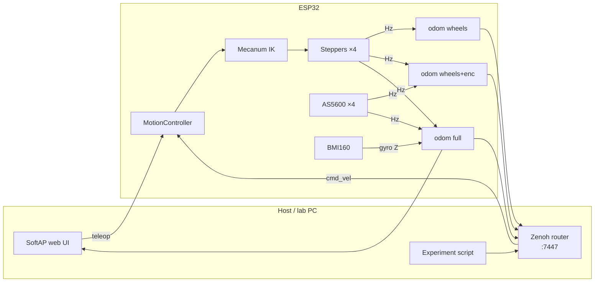
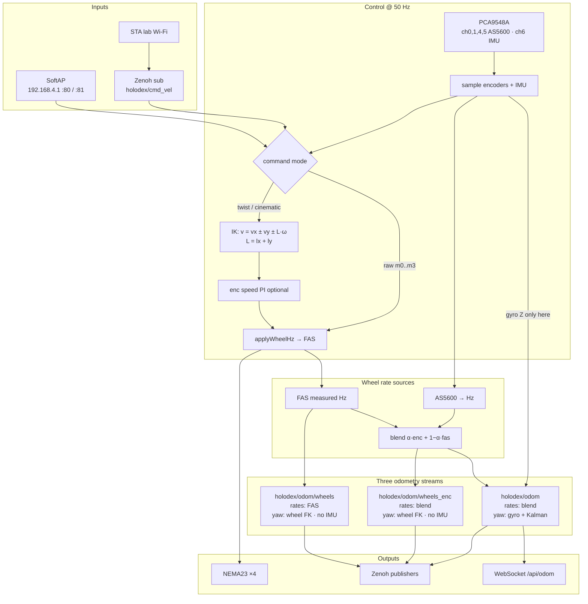
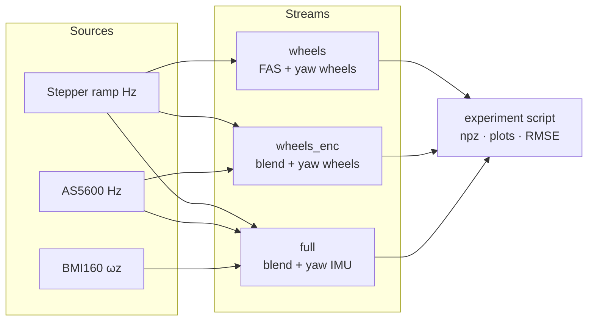

# HoloDex

VerLab **mecanum** robot: 4× NEMA23 steppers, AS5600 encoders (PCA9548A), BMI160 IMU, ESP32 control.

## Overview

| Area | Description |
|------|-------------|
| **Actuation** | NEMA23 steppers + drivers (2 A via Vref) |
| **Mechanics** | 4WD mecanum wheels — spin about chassis center |
| **Onboard control** | Mecanum IK/FK, SoftAP web teleop, optional enc speed PI |
| **Sensing** | 4× AS5600 + BMI160 on PCA9548A |
| **Odometry** | Three parallel streams for comparison (wheels / wheels+enc / full+IMU) |
| **ROS path** | Zenoh `cmd_vel` + three `odom*` topics |

## Architecture (high level)



## Architecture (detailed)



## Odometry comparison (article)



| Stream | Topic | Wheel rates | Yaw |
|--------|-------|-------------|-----|
| **wheels** | `holodex/odom/wheels` | FastAccelStepper only | wheel FK (no IMU) |
| **wheels_enc** | `holodex/odom/wheels_enc` | FAS + AS5600 blend | wheel FK (no IMU) |
| **full** | `holodex/odom` | FAS + AS5600 blend | gyro + Kalman |

## Mecanum kinematics

Early firmware (`5ed7a02`) only accepted **raw motor Hz** over Zenoh (no onboard IK). A later 45° omni û-model with swapped yaw/strafe columns did **not** spin about the chassis center.

Firmware **0.4.x** uses standard mecanum ([reference](https://github.com/Shimraz/Kinematics-of-Mobile-Robot)):

\[
\begin{aligned}
v_{FL} &= v_x - v_y - L\omega \\
v_{RL} &= v_x + v_y - L\omega \\
v_{FR} &= v_x + v_y + L\omega \\
v_{RR} &= v_x - v_y + L\omega
\end{aligned}
\quad L = l_x + l_y
\]

Motor order: **M0=FL, M1=RL, M2=FR, M3=RR**. Left motors use `motor_sign = −1` (DIR mirrored). Encoders: mux **ch0,1,4,5**; IMU: **ch6**.

## Repository layout

| Path | Role |
|------|------|
| `firmware/` | ESP32 PlatformIO stack (primary) |
| `docker/` | Zenoh router (+ experiment profile) |
| `experiments/` | Triple-odom capture (npz / plots / MSE) |
| `src/` | Legacy desktop UI (optional) |

## Quick start (web teleop)

1. Build & flash:
   ```bash
   cd firmware && pio run -t upload
   ```
2. Join SoftAP **`HoloDex`** / **`holodex123`**
3. Open **http://192.168.4.1/**
4. Drive tab: joysticks; Config: encoder mux map, STA, Zenoh endpoint

### Hardware defaults

| Parameter | Value |
|-----------|--------|
| Wheel radius | 50 mm |
| Microstepping | 32 → **6400** steps/rev |
| Wheelbase / 2 (`lx`) | 0.19 m |
| Track / 2 (`ly`) | 0.195 m |
| I2C | SDA 21, SCL 5 · mux `0x70` |

## Zenoh + odometry experiment

```bash
cd docker && docker compose up -d zenoh
# On robot web Config: STA + tcp/<your-PC-LAN-IP>:7447
docker compose --profile experiment run --rm experiment
```

Details: [experiments/README.md](experiments/README.md).

| Topic | Direction | Content |
|-------|-----------|---------|
| `holodex/cmd_vel` | → robot | `{"vx","vy","omega"}` SI |
| `holodex/odom` | ← robot | wheels+enc+IMU (full) |
| `holodex/odom/wheels` | ← robot | stepper rates, yaw from wheels |
| `holodex/odom/wheels_enc` | ← robot | encoder blend, yaw from wheels |

## Contribution

Branch from `dev`; PRs → `dev` → `main`. See [CONTRIBUTING.md](CONTRIBUTING.md).

## VerLab

Internal [VerLab](https://github.com/verlab) project — private repository.
