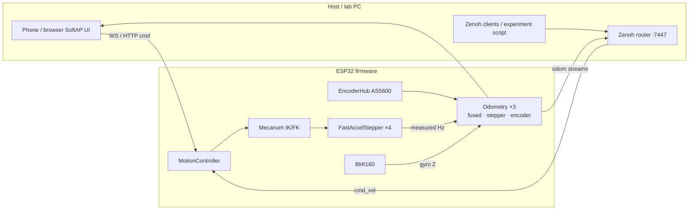
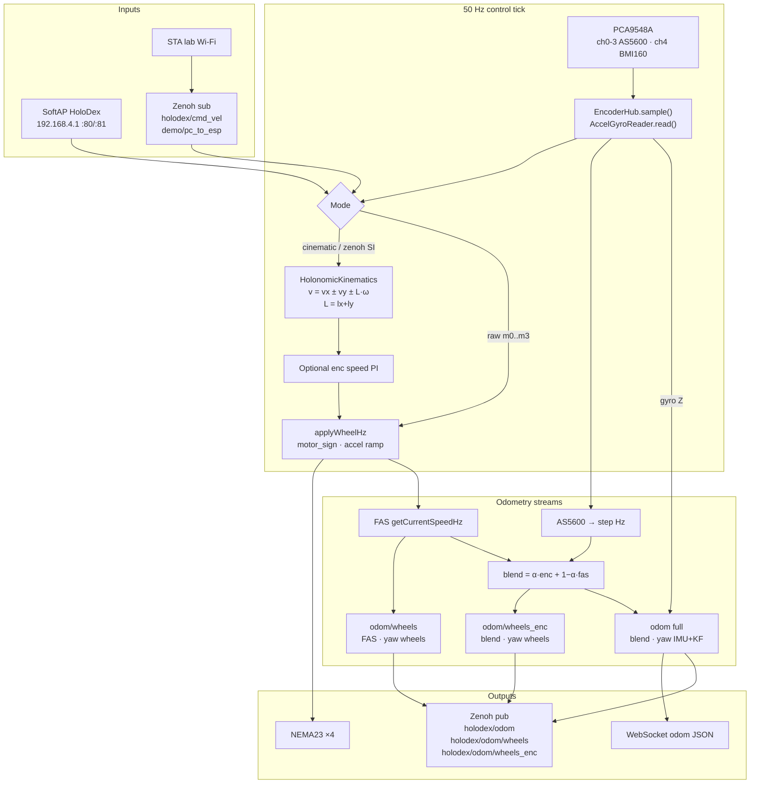

# HoloDex

VerLab **mecanum** robot: 4× NEMA23 steppers, AS5600 encoders (PCA9548A), BMI160 IMU, ESP32 control.

## Overview

| Area | Description |
|------|-------------|
| **Actuation** | NEMA23 steppers + drivers (2 A via Vref) |
| **Mechanics** | 4WD mecanum wheels — spin about chassis center |
| **Onboard control** | Mecanum IK/FK, dual odometry, SoftAP web teleop |
| **Sensing** | 4× AS5600 + BMI160 on PCA9548A |
| **ROS path** | Zenoh (`holodex/cmd_vel`, `holodex/odom` + compare topics) |

## Architecture (high level)



## Architecture (detailed)



### Why kinematics changed (vs early Zenoh-only firmware)

At commit `5ed7a02` the ESP32 only accepted **raw motor step-Hz** over Zenoh — there was **no onboard IK/odometry**. Later firmware introduced a 45° **omni û-model** with yaw/strafe columns swapped for teleop; that mix does **not** match mecanum and does not keep yaw rotation about the geometric center, so integrated θ drifted badly.

Firmware **0.4.0+** uses standard mecanum (same structure as [Shimraz/Kinematics-of-Mobile-Robot](https://github.com/Shimraz/Kinematics-of-Mobile-Robot)):

\[
\begin{aligned}
v_{FR} &= v_x + v_y + L\omega \\
v_{RR} &= v_x - v_y + L\omega \\
v_{FL} &= v_x - v_y - L\omega \\
v_{RL} &= v_x + v_y - L\omega
\end{aligned}
\quad L = l_x + l_y
\]

Motor order on HoloDex: **M0=FR, M1=RR, M2=FL, M3=RL**.

## Repository layout

| Path | Role |
|------|------|
| `firmware/` | ESP32 PlatformIO stack (primary) |
| `docker/` | Zenoh router (+ experiment profile) |
| `experiments/` | Dual-odom capture script (npz / plots / MSE) |
| `src/` | Legacy desktop UI (optional) |

## Quick start (web teleop)

1. Build & flash:
   ```bash
   cd firmware && pio run -t upload
   ```
2. Join SoftAP **`HoloDex`** / **`holodex123`**
3. Open **http://192.168.4.1/**
4. Drive tab: joysticks; Config: encoder mux map, STA, Zenoh endpoint

### Hardware defaults

| Parameter | Value |
|-----------|--------|
| Wheel radius | 50 mm |
| Microstepping | 32 → **6400** steps/rev |
| Wheelbase / 2 (`lx`) | 0.19 m |
| Track / 2 (`ly`) | 0.195 m |
| I2C | SDA 21, SCL 5 · mux `0x70` |

## Zenoh + odometry experiment

```bash
cd docker && docker compose up -d zenoh
# On robot web Config: STA + tcp/<your-PC-LAN-IP>:7447
docker compose --profile experiment run --rm experiment
```

Details: [experiments/README.md](experiments/README.md).

Topics:

| Topic | Direction | Content |
|-------|-----------|---------|
| `holodex/cmd_vel` | → robot | `{"vx","vy","omega"}` SI |
| `holodex/odom` | ← robot | wheels+enc+IMU (full) |
| `holodex/odom/wheels` | ← robot | stepper rates, yaw from wheels |
| `holodex/odom/wheels_enc` | ← robot | encoder blend, yaw from wheels |

## Contribution

Branch from `dev`; PRs → `dev` → `main`. See [CONTRIBUTING.md](CONTRIBUTING.md).

## VerLab

Internal [VerLab](https://github.com/verlab) project — private repository.
