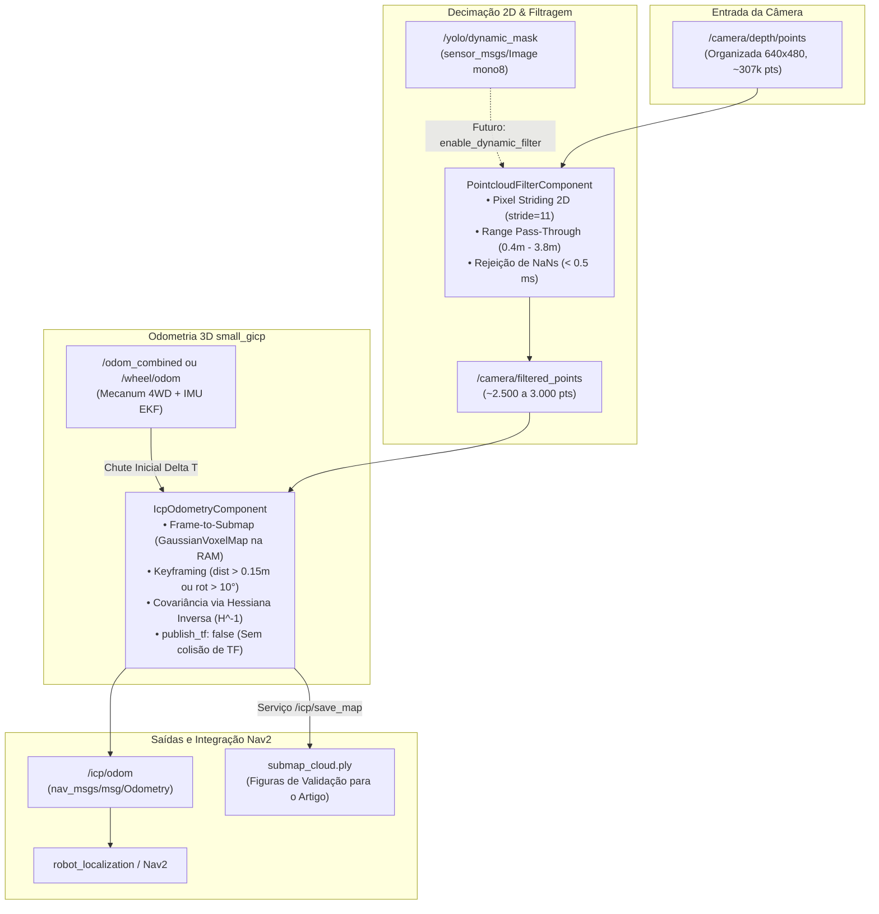

# pointcloud_odometry (ROS 2 Humble / ARM64 & x86)

Nó de alto desempenho para **Odometria 3D por Nuvem de Pontos** baseado em **`small_gicp` (VGICP)** e decimação 2D rápida por **Pixel Striding**, projetado para robôs com rodas **Mecanum 4WD**, fusão sensorial via **EKF (`robot_localization`)** e navegação autônoma com o **Nav2**.

Desenvolvido para a câmera RGB-D **Orbbec Astra Pro** e testado na **Orange Pi 4 Pro** (Allwinner A733, 8 núcleos ARM Cortex-A55/A76, Ubuntu 22.04 Jammy).

---

## 1. Arquitetura e Decisões Críticas de Projeto



### Principais Diferenciais:
1. **Resolução de Conflito de TF (Crucial para Nav2)**:
   - Em robôs Mecanum com IMU, o `robot_localization` é o único responsável por publicar a transformação `odom -> base_link`.
   - Por padrão, `publish_tf: false`. O nó calcula a pose exclusivamente a partir da nuvem 3D e publica `nav_msgs/msg/Odometry` em `/icp/odom` com as matrizes de covariância ($6 \times 6$) devidamente preenchidas.
2. **Chute Inicial (Initial Guess) via Sensor Fusion**:
   - Rodas Mecanum deslizam lateralmente e a câmera Astra Pro possui FoV horizontal de ~60°. O alinhamento ICP cego perde convergência durante rotações rápidas.
   - O nó assina `/odom_combined` (ou `/wheel/odom`), calcula o incremento relativo $\Delta T$ e o injeta como chute inicial para a otimização de Levenberg-Marquardt do `small_gicp`.
3. **Decimação 2D Direta (Sem VoxelGrid 3D pesado)**:
   - A nuvem da Astra Pro é organizada ($640 \times 480$). Calcular hashes tridimensionais (`pcl::VoxelGrid`) sobre 307.200 pontos a cada frame satura os núcleos ARM.
   - O componente utiliza **Pixel Striding** (passo configurável de 10 a 14 pixels em $u$ e $v$), reduzindo a nuvem para ~2.500 pontos em **menos de 0,5 ms** na CPU.
4. **Frame-to-Submap na RAM com Keyframing**:
   - Evita o drift severo de abordagens Frame-to-Frame ingênuas.
   - Mantém um `small_gicp::GaussianVoxelMap` incremental na memória RAM.
   - Novos pontos só são inseridos no submapa se o robô se deslocar $\Delta d > 0{,}15\text{ m}$ ou girar $\Delta \theta > 10^\circ$.
5. **Zero-Copy DDS via `rclcpp_components`**:
   - Ambos os nós são implementados como **Composable Nodes**, podendo rodar no mesmo processo (`odometry_pipeline_container`) usando *intra-process communication* sem sobrecarga de serialização DDS.
6. **Exportação de Submapa Consolidado para o Artigo**:
   - Provê o serviço `/icp/save_map` (e `/save_pointcloud_map`) que consolida os pontos em um arquivo `.ply` (compatível com CloudCompare, MeshLab e RViz) para geração de gráficos e figuras no paper.
7. **Arquitetura Pronta para YOLOv8-seg**:
   - O subscriber para `/yolo/dynamic_mask` já está implementado.
   - Controlado pelo parâmetro `enable_dynamic_filter: false`. Não consome CPU/NPU enquanto o modelo neural estiver em fine-tuning.

---

## 2. Como Compilar

### Na Orange Pi 4 Pro (ou Máquina Host)

```bash
# 1. Carregar ambiente ROS 2 Humble
source /opt/ros/humble/setup.bash

# 2. Criar ou acessar seu workspace ROS 2
mkdir -p ~/ros2_ws/src
cd ~/ros2_ws/src

# 3. Copiar ou criar link simbólico do pacote
ln -s /home/alisson/orange/pointcloud_odometry pointcloud_odometry

# 4. Compilar com colcon em modo Release
cd ~/ros2_ws
colcon build --packages-select pointcloud_odometry --cmake-args -DCMAKE_BUILD_TYPE=Release -DCMAKE_EXPORT_COMPILE_COMMANDS=ON

# 5. Carregar o overlay
source ~/ros2_ws/install/setup.bash
```

---

## 3. Como Executar

### Opção A: Pipeline Completo com Container Zero-Copy (Recomendado)

Inicia o container multithreaded contendo o filtro e a odometria integrados com comunicação intra-processo:

```bash
ros2 launch pointcloud_odometry pointcloud_odometry.launch.py
```

Parâmetros opcionais via CLI:
```bash
ros2 launch pointcloud_odometry pointcloud_odometry.launch.py \
    initial_guess_topic:=/odom_combined \
    publish_tf:=false \
    enable_dynamic_filter:=false
```

### Opção B: Utilizando o Orquestrador / Monitor em Python

O script `pipeline_orchestrator.py` monitora em tempo real a taxa de quadros (Hz), a saúde dos tópicos e permite disparar o salvamento do mapa:

```bash
# Apenas monitorar tópicos já em execução:
ros2 run pointcloud_odometry pipeline_orchestrator.py

# Subir a pipeline e monitorar:
ros2 run pointcloud_odometry pipeline_orchestrator.py --launch-all
```

Durante a execução do orquestrador:
- Pressione `s` para salvar o submapa 3D atual em `.ply`.
- Pressione `q` para encerrar o sistema de forma limpa.

### Opção C: Execução Manual dos Nós Standalone

Terminal 1 (Filtro e Decimação):
```bash
ros2 run pointcloud_odometry pointcloud_filter_node
```

Terminal 2 (Odometria small_gicp):
```bash
ros2 run pointcloud_odometry icp_odometry_node
```

---

## 4. Salvando o Submapa para o Artigo Científico

Você pode disparar o serviço de exportação a qualquer momento via terminal:

```bash
# Via script CLI auxiliar:
ros2 run pointcloud_odometry save_map.py

# Ou diretamente via chamada de serviço ROS 2:
ros2 service call /icp/save_map std_srvs/srv/Trigger "{}"
```

O arquivo consolidado será gerado por padrão em `/home/orangepi/submap_cloud.ply` (ou no caminho configurado no parâmetro `default_map_path`).

---

## 5. Tópicos e Serviços

| Nome | Tipo | Descrição |
| :--- | :--- | :--- |
| `/camera/depth/points` | `sensor_msgs/msg/PointCloud2` | Nuvem bruta da câmera Astra Pro (640x480). |
| `/camera/filtered_points` | `sensor_msgs/msg/PointCloud2` | Nuvem decimada por pixel-striding (~2.500 pts). |
| `/odom_combined` | `nav_msgs/msg/Odometry` | Odometria do EKF/encoders usada como chute inicial. |
| `/icp/odom` | `nav_msgs/msg/Odometry` | Odometria 3D calculada pelo alinhamento geométrico. |
| `/yolo/dynamic_mask` | `sensor_msgs/msg/Image` | Máscara de objetos dinâmicos (mono8, opcional). |
| `/icp/save_map` | `std_srvs/srv/Trigger` | Exporta os pontos acumulados em arquivo `.ply`. |

